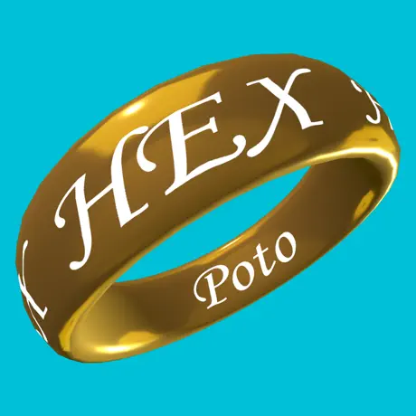

  

I'm an engineer and enthusiast who enjoys finding ways to make things work better.
I like hiding repetitive work behind elegant, dependable solutions.
C++ is a long-standing love, but I believe in choosing the right tool for the job.

## What I'm building

### [otok](https://github.com/otok-dev/otok)

Getting third-party libraries into a project shouldn't be a recurring problem.
otok builds native dependencies from source with the options and platforms your
project needs, then integrates them with your build.

**Apple &middot; Android &middot; Windows &middot; Linux** 
[Repository](https://github.com/otok-dev/otok) &nbsp;/&nbsp;
[Documentation](https://otok-dev.github.io/) &nbsp;/&nbsp;
[Library catalog](https://otok-dev.github.io/index/)

If there's something you need otok to do, [open an issue](https://github.com/otok-dev/otok/issues).
[Sponsoring its development](https://github.com/sponsors/apotocki) helps me dedicate
more time to the problems that matter to you.

## Other projects

- **[Numetron](https://github.com/apotocki/numetron)** — a work-in-progress C++ library exploring arbitrary-precision integers and decimals, including compile-time arithmetic.
- **[Annium](https://github.com/apotocki/annium-lang)** — an experimental programming language, currently in development.
- **[dataforge](https://github.com/apotocki/dataforge)** — composable C++20 data transformation pipelines.
- **Apple XCFrameworks** — [Boost](https://github.com/apotocki/boost-iosx), [ICU](https://github.com/apotocki/icu4c-iosx), and [OpenSSL](https://github.com/apotocki/openssl-iosx) builds for Apple platforms.
- **PotoHEX / Otok Hex** — mobile tools for inspecting binary files. 
  
  &nbsp;
   
  [App Store](https://apps.apple.com/us/app/potohex/id1620963302) &middot; [Google Play](https://play.google.com/store/apps/details?id=com.potohex)

## Activity

Public stars across my repositories and otok-dev, excluding forks &middot;
Public commit contributions in the last 30 days
